<div align="center">


# Smali Helper Plus

**The modern, offline Smali & Dalvik bytecode reference for Android developers.**

Every Dalvik opcode explained with real examples, a 28-lesson academy, a validating Smali editor and a full
developer toolbox, in a Material 3 app built with Kotlin and Jetpack Compose. Made for Android reverse engineering,
reading `apktool` / `baksmali` output, and learning how DEX bytecode really works.

[](https://github.com/riyadmondol2006/Smali-Helper-Plus/actions/workflows/android-ci.yml)
[](https://github.com/riyadmondol2006/Smali-Helper-Plus/actions/workflows/release.yml)
[](https://github.com/riyadmondol2006/Smali-Helper-Plus/releases/latest)
[](LICENSE)
-3DDC84?logo=android&logoColor=white)


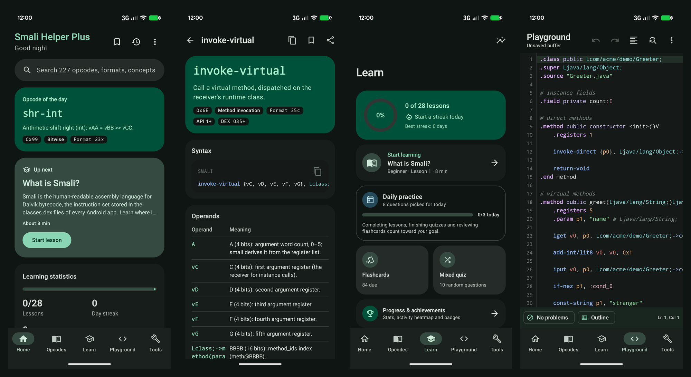

</div>

---

## Download

Grab the latest signed APK from **[Releases](https://github.com/riyadmondol2006/Smali-Helper-Plus/releases/latest)**
(`Smali-Helper-Plus-v<version>.apk`, with a `.sha256` checksum). A new version is published automatically after
every successful push to `main`, and updates install over the previous version.

Requirements: Android 8.0 (API 26) or newer. No root, no account, works fully offline.

## Why Smali Helper Plus?

Smali Helper Plus is a modern take on Zylern's original
[Smali Helper](https://github.com/Zylern/Smali-Helper): the same idea, a pocket opcode reference grouped by
category, rebuilt from scratch with verified documentation, a premium Material You interface and many new tools. No
code or text from the original was reused.

| | Original Smali Helper | Smali Helper Plus |
|---|---|---|
| Opcode reference | One screen per opcode | 227 entries (all 224 instructions + 3 payloads) in 19 categories, verified against the official AOSP docs |
| Per opcode | Short description | Syntax, format, operands, explanation, technical details, example, Java/Kotlin equivalent, register usage, API level, common mistakes, related opcodes, official references |
| Search | | Instant, typo-tolerant (`invok-static` → `invoke-static`), searches formats, examples and descriptions |
| Learning | Info pages | 28 lessons, quizzes, flashcards, daily practice, streaks and achievements |
| Editor | | Smali Playground with highlighting, live diagnostics, formatter, autocomplete, find & replace |
| Tools | | 13 developer tools (register calculator, converters, explainer, control flow, diff, ...) |
| Design | Classic views | Material 3, dynamic color, light/dark, edge-to-edge, tablet layouts |

## Screenshots

<table>
  <tr>
    <td align="center">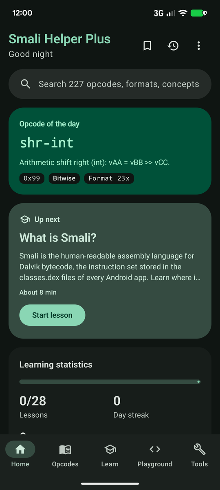<br><sub><b>Home</b>: opcode of the day, continue learning, stats</sub></td>
    <td align="center">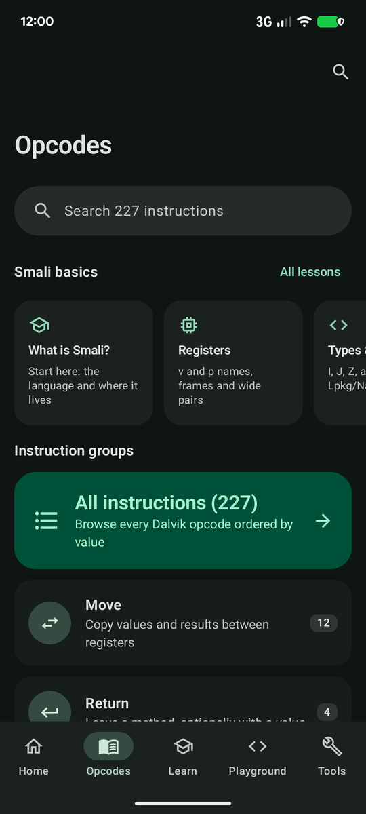<br><sub><b>Opcodes</b>: Smali basics and 19 categories</sub></td>
    <td align="center">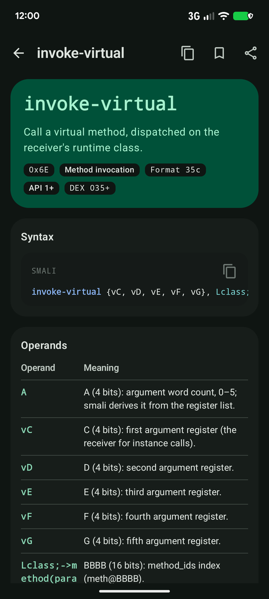<br><sub><b>Opcode detail</b>: format, operands, API level</sub></td>
  </tr>
  <tr>
    <td align="center">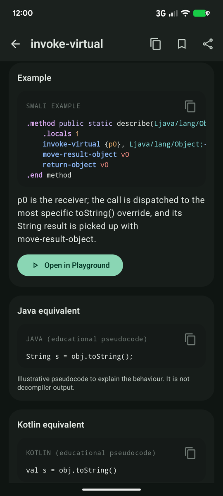<br><sub><b>Examples</b>: highlighted Smali + Java equivalent</sub></td>
    <td align="center">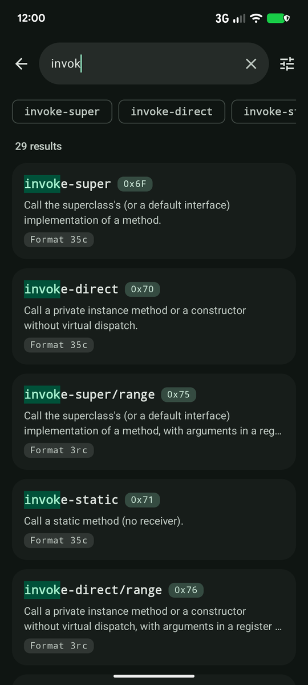<br><sub><b>Search</b>: typo-tolerant with highlights</sub></td>
    <td align="center">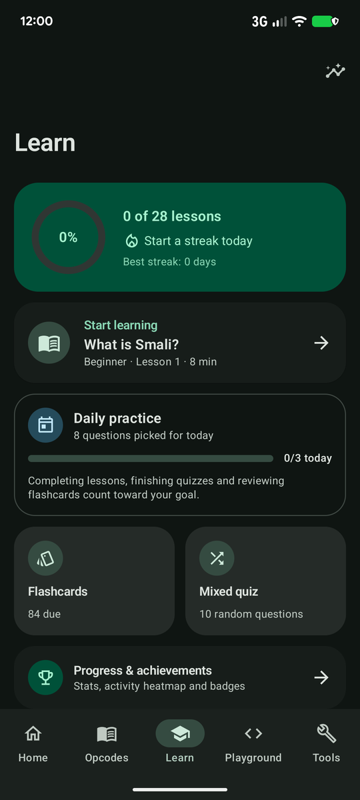<br><sub><b>Learn</b>: lessons, daily practice, flashcards</sub></td>
  </tr>
  <tr>
    <td align="center">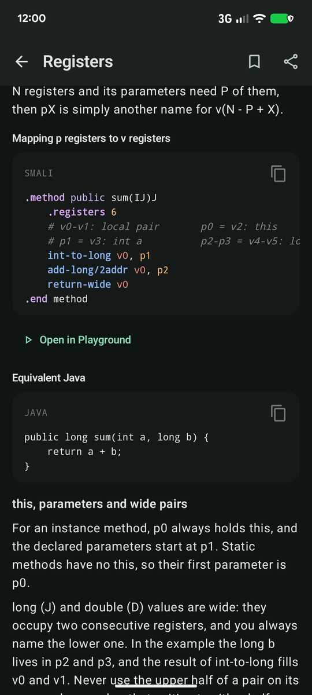<br><sub><b>Lessons</b>: Smali next to Java</sub></td>
    <td align="center">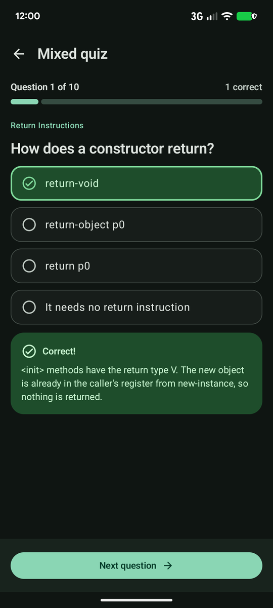<br><sub><b>Quizzes</b>: instant feedback and explanations</sub></td>
    <td align="center">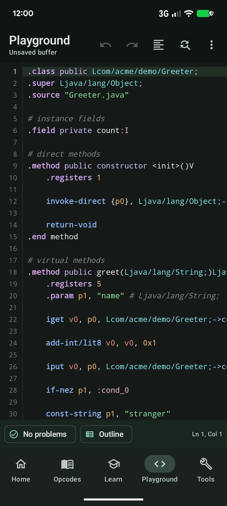<br><sub><b>Playground</b>: editor with live diagnostics</sub></td>
  </tr>
  <tr>
    <td align="center">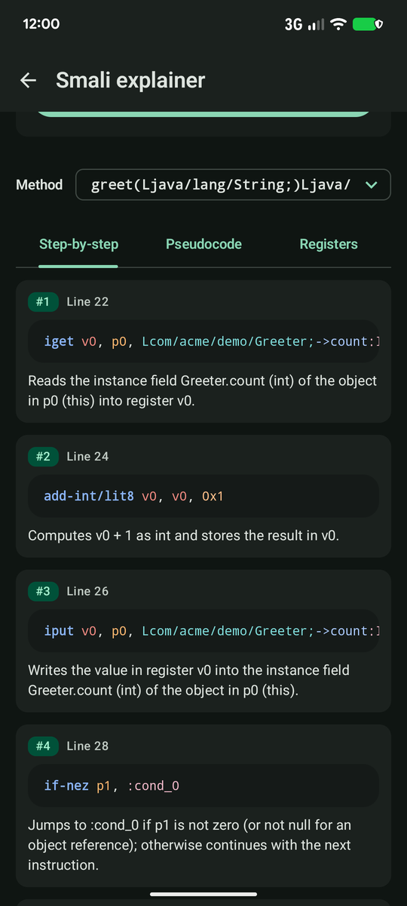<br><sub><b>Explainer</b>: step-by-step + pseudocode</sub></td>
    <td align="center">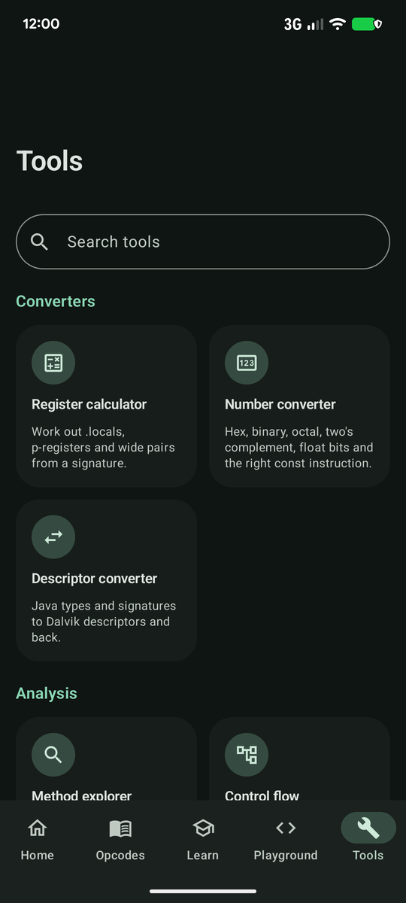<br><sub><b>Tools</b>: 13 developer utilities</sub></td>
    <td align="center">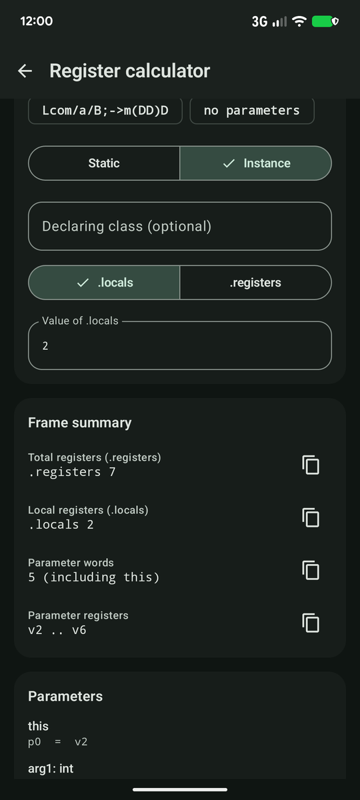<br><sub><b>Register calculator</b>: p↔v mapping, wide pairs</sub></td>
  </tr>
</table>

<details>
<summary><b>Light theme and Material You dynamic color</b></summary>
<br>
<table>
  <tr>
    <td align="center">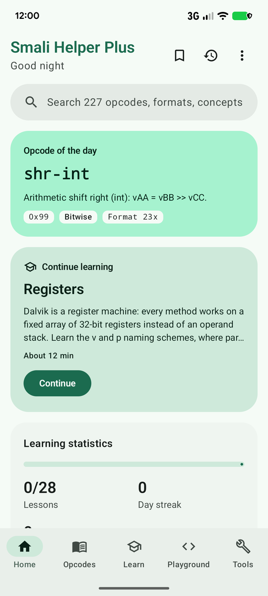<br><sub>Home (light)</sub></td>
    <td align="center">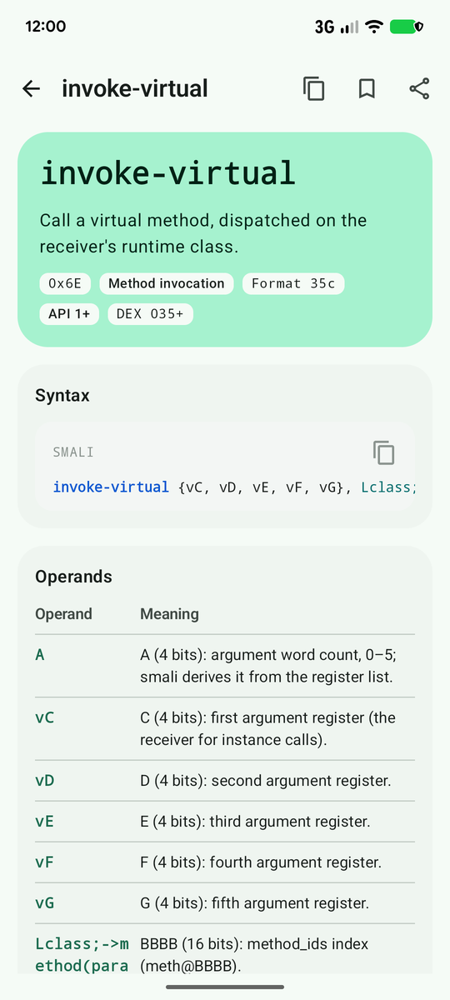<br><sub>Opcode detail (light)</sub></td>
    <td align="center">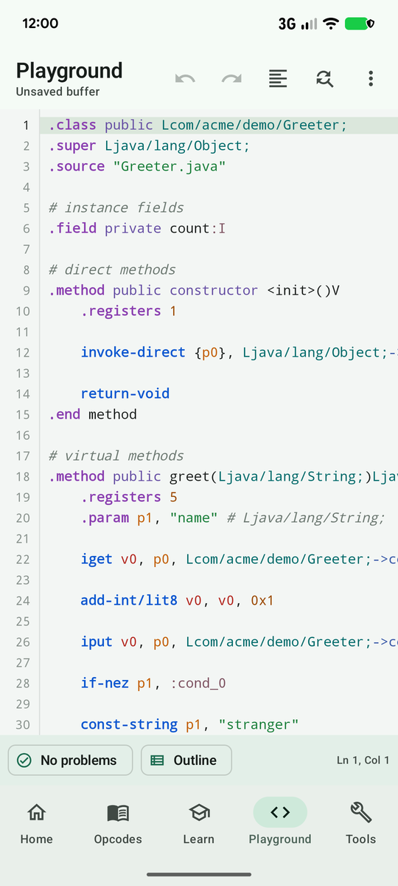<br><sub>Playground (light)</sub></td>
    <td align="center">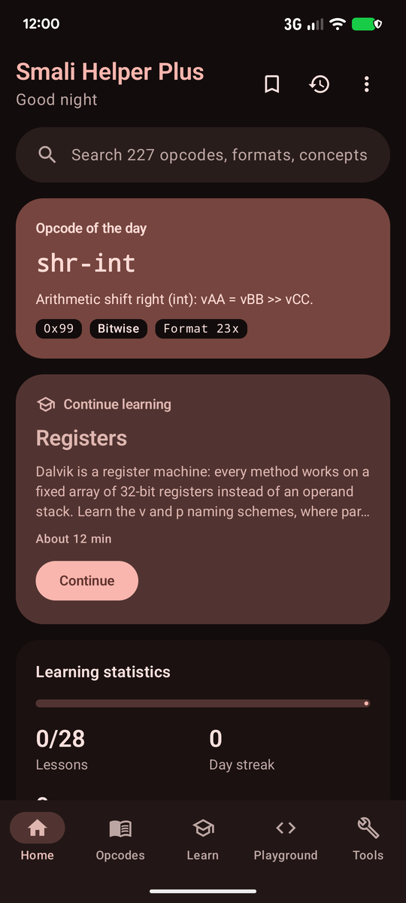<br><sub>Dynamic color from wallpaper</sub></td>
  </tr>
</table>
</details>

All screenshots were taken on a Google Pixel 6 (Android 17).

## Features

### Opcode reference (the core)
- **All 224 Dalvik instructions + 3 data payloads**, generated from and cross-checked against the official
  [Dalvik bytecode](https://source.android.com/docs/core/runtime/dalvik-bytecode) and
  [instruction formats](https://source.android.com/docs/core/runtime/instruction-formats) pages. Every example
  assembles with the real smali assembler.
- 19 categories: move, return, constants, monitors, type checks, objects, arrays, fields, invoke, arithmetic,
  bitwise, comparison, branches, jumps, switches, conversions, exceptions, method handles, advanced.
- Each opcode: value, format, syntax, operands with bit widths, explanation, technical description, real example,
  Java and Kotlin equivalents, register usage, minimum API / DEX version, common mistakes, related opcodes and
  official references. Copy, bookmark and share buttons.
- "Smali basics" shortcuts (what Smali is, registers, types, method signatures, debugging), like the info pages of
  the original app.

### Search
Instant offline search over names, categories, formats (`35c`), syntax, descriptions and example code, with typo
tolerance, suggestions and "did you mean", filters (category, format, min API, wide, range), highlighted matches and
recent searches.

### Learning academy
28 original lessons from "What is Smali?" to DEX structure, instruction encoding, annotations and reading
obfuscated code, each with code examples, Java comparisons, exercises (open in the Playground) and a quiz. Also
141 quiz questions, 84 flashcards with spaced repetition, daily practice, streaks, a 12-week activity heatmap and 13
achievements. All progress is stored locally.

### Smali Playground
A real editor: syntax highlighting, line numbers, auto-indent, undo/redo, find & replace, opcode autocomplete,
register and bracket highlighting, live diagnostics (unknown opcodes, register limits per format, literal ranges,
undefined labels, return-type mismatches, ...), a formatter, a method outline, editor themes and font sizes, snippet
saving, and `.smali` open/save through the system file picker. Code is only parsed and validated, **never compiled
or executed**.

### Developer tools
Register calculator · number converter (dec/hex/bin/oct, signed/unsigned, float bits, "which const fits") ·
descriptor converter (`java.lang.String` ↔ `Ljava/lang/String;`, method signatures) · method explorer · control-flow
viewer · Smali explainer with educational Java-style pseudocode · register usage visualizer · code comparison (diff)
· API compatibility checker · instruction format explorer · cheat sheets · snippet library (77 snippets + your own
collections).

### And more
Bookmarks and history, backup and restore (JSON via the file picker), documentation updates without an app update
(validated JSON, HTTPS only, atomic install, never code), and an **optional** bring-your-own-key AI assistant that
asks before sending any code. Material 3 with dynamic color, light/dark themes, edge-to-edge, predictive back,
adaptive phone/tablet layouts and large-font support.

## Versioning and automatic releases

Versions are fully automatic; nobody edits version numbers by hand:

| Value | Formula | Example |
|---|---|---|
| `versionCode` | number of commits | 1, 2, 3, ... |
| `versionName` | `<major>.<minor>.<commits - 1>` (major/minor in [`version.properties`](version.properties)) | 1.0.0, 1.0.1, 1.0.2, ... |
| Release tag | `v<versionName>` | `v1.0.2` |

```
push to main ──► Android CI (lint · unit tests · debug APK · Pixel 6 emulator tests)
                      │ success
                      ▼
                 Release workflow ──► builds + signs release APK ──► GitHub Release v1.0.N
                                                                    (APK · SHA-256 · build-info · changelog)
```

Pushes to other branches and pull requests are built and tested but never released. Signing uses four repository
secrets; see [Setup](#setup-for-maintainers). Run `./gradlew printVersion` to see the version locally, and bump
`minor`/`major` in `version.properties` to start a new line (for example 1.1.0).

## Setup for maintainers

**Debug builds, tests and CI need no configuration.** Automatic releases need four repository secrets. Add them
under **Settings → Secrets and variables → Actions → New repository secret**:

| Secret | What to put in it |
|---|---|
| `ANDROID_KEYSTORE_BASE64` | Your release keystore, base64 on one line: `base64 -w0 release.jks` |
| `ANDROID_KEYSTORE_PASSWORD` | The keystore password |
| `ANDROID_KEY_ALIAS` | The key alias you chose |
| `ANDROID_KEY_PASSWORD` | The key password |

Create the keystore once, on your own machine, and back it up (losing it means you can no longer ship updates):

```bash
keytool -genkeypair -v -keystore release.jks -keyalg RSA -keysize 4096 -validity 10000 -alias smalihelper
```

No other secrets, variables, `.env` files or tokens are needed: publishing uses the built-in `GITHUB_TOKEN`, the AI
key is entered by each user inside the app, and documentation updates come from this public repository. Step-by-step
details: [SECRETS_SETUP.md](SECRETS_SETUP.md) and [CI_SETUP.md](CI_SETUP.md).

## Build from source

Requirements: JDK 21, Android SDK platform `android-37.0` and build-tools `37.0.0`. The Gradle wrapper (9.8.2)
downloads Gradle itself.

```bash
export JAVA_HOME=/usr/lib/jvm/java-21-openjdk     # any JDK 21
./gradlew clean
./gradlew lintDebug
./gradlew testDebugUnitTest                       # 438 JVM unit tests
./gradlew assembleDebug                           # app/build/outputs/apk/debug/app-debug.apk
./gradlew connectedDebugAndroidTest               # 60 Compose UI tests, needs a device or emulator
```

A local `./gradlew assembleRelease` is unsigned unless the signing environment variables are set (see
[SECRETS_SETUP.md](SECRETS_SETUP.md)).

## Testing

- **438 JVM unit tests**: the Smali lexer/parser/validator/formatter, search engine, converters, learning logic,
  content validation, update pipeline, backup and AI client.
- **60 instrumented Compose UI tests**: navigation, opcode reference, search, lessons and quizzes, Playground,
  tools, settings and Room. They pass on a physical **Google Pixel 6** (Android 17) and run on a Pixel 6 emulator
  profile in CI.
- [docs/TESTING.md](docs/TESTING.md) has the Pixel 6 device matrix (cold start, dynamic color, light/dark, gesture
  and 3-button navigation, font scale, rotation, offline, process death) with the adb commands.
  `scripts/pixel6-local-test.sh` automates it for a connected device.
- Before pushing: `scripts/check-secrets.sh` scans the tree for committed secrets.

## Architecture

Single module `:app`, MVVM with unidirectional data flow and Clean Architecture layering. Compose screens observe
`StateFlow`s from `@HiltViewModel`s with `collectAsStateWithLifecycle()`.

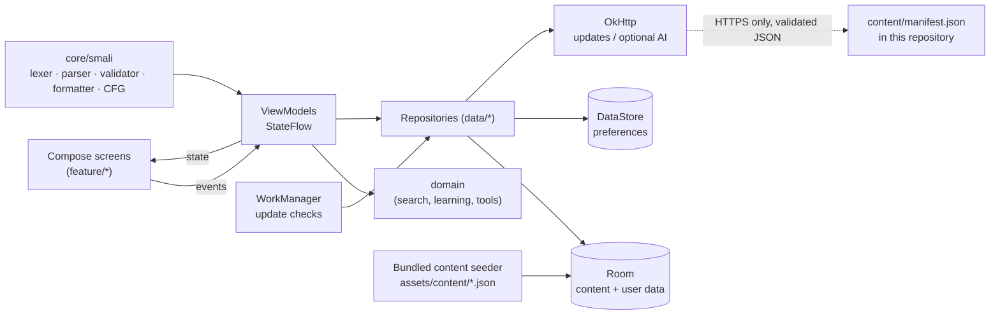

Kotlin 2.4 · Jetpack Compose (BOM 2026.09) · Material 3 · Hilt · Room · DataStore · WorkManager · Navigation Compose
(type-safe routes) · kotlinx.serialization · OkHttp. Exact versions and sources: [VERSIONS.md](VERSIONS.md).

```
app/src/main/java/com/riyadm/smalihelperplus/
├── core/
│   ├── smali/           Smali engine: lexer, parser, validator, formatter, explainer, register & control-flow analysis
│   ├── content/         content DTOs, validator, atomic installer, bundled content seeder
│   ├── database/        Room database, entities, DAOs (FTS4 opcode index)
│   ├── datastore/       user preferences
│   ├── designsystem/    theme, code colors, shared components (CodeBlock, EmptyState, ...)
│   ├── common/ di/      code hand-off between screens, Hilt modules
├── data/                repositories: opcode, learning, snippets, library, updates, backup, ai
├── domain/              pure logic: search engine, learning (streaks, Leitner, achievements), tools
├── feature/             home · opcodes · search · learn · playground · explainer · analysis · tools · snippets ·
│                        library · settings · updates · about · ai
└── navigation/          type-safe routes, NavHost, adaptive navigation suite
```

Content lives in `app/src/main/assets/content/` (opcodes, lessons, snippets). The generators and the verification
tooling (which assembles every example with real smali) are in [`tools/content-gen/`](tools/content-gen/).

## Privacy and responsible use

- No analytics, no ads, no tracking. The only network uses are the optional documentation update check and the
  optional AI assistant you configure yourself. Code and keys are never logged.
- The AI key is stored with the Android Keystore and excluded from backups. Nothing is sent before you configure the
  assistant, and the app always asks before sending code.
- Smali Helper Plus is for learning and for analysing software you wrote or are authorised to inspect. Do not use it
  to bypass licensing, payments or other protections. The app never executes the code you paste or import and needs
  no root.

## Documentation

| File | Content |
|---|---|
| [CI_SETUP.md](CI_SETUP.md) | CI jobs, automatic versioning and releases, artifacts, emulator details |
| [SECRETS_SETUP.md](SECRETS_SETUP.md) | Release signing secrets and keystore handling |
| [VERSIONS.md](VERSIONS.md) | Pinned versions, official sources, verification date |
| [docs/TESTING.md](docs/TESTING.md) | Test levels and the Pixel 6 device matrix |
| [content/README.md](content/README.md) | Documentation update format |
| [NOTICE.md](NOTICE.md) | Third-party attribution |

## License

Copyright 2026 riyadmondol2006. Licensed under the [Apache License, Version 2.0](LICENSE). Third-party notices are in
[NOTICE.md](NOTICE.md). Inspired by [Smali Helper](https://github.com/Zylern/Smali-Helper) by Zylern. "Android" and
"Pixel" are trademarks of Google LLC; this project is not affiliated with Google.
